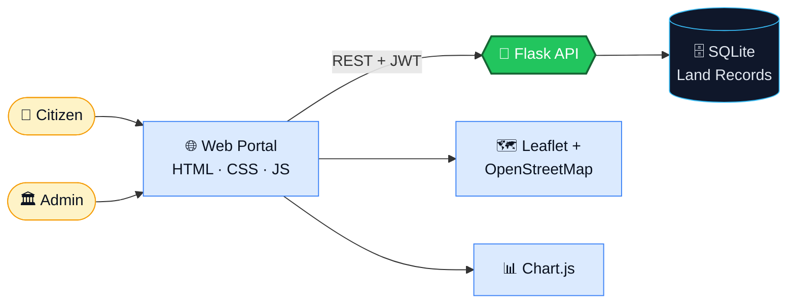
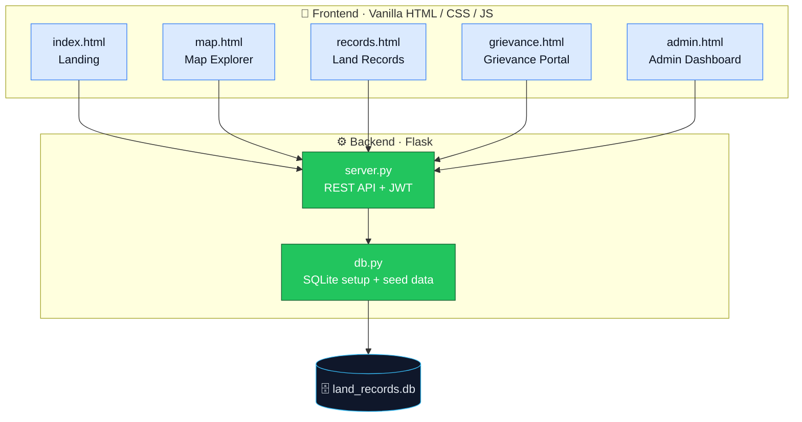
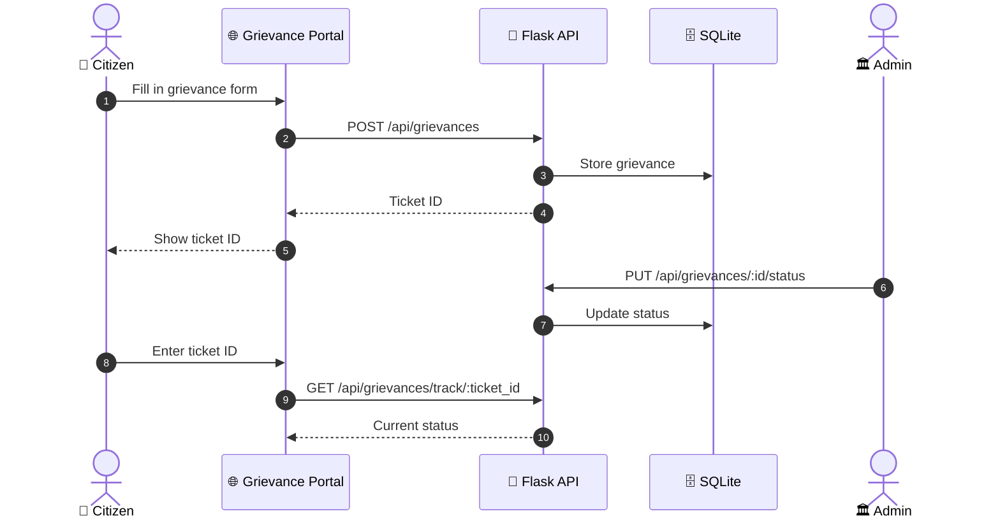
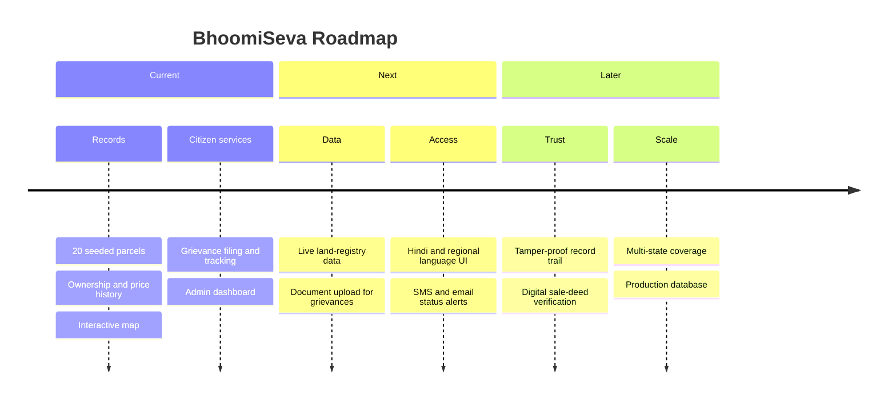

<div align="center">


<br/>

**A secure, transparent full-stack web platform for land record management and citizen grievance redressal. Built for the Digital India Initiative at InnoHack.**

<br/>

[](https://www.python.org/)
[](https://flask.palletsprojects.com/)
[](https://www.sqlite.org/)
[](https://leafletjs.com/)
[](https://www.chartjs.org/)
[](https://debuggers-innohack.vercel.app)

<br/>

[](https://debuggers-innohack.vercel.app)
[](https://github.com/Lakshya0023/DEBUGGERS_INNOHACK)

<br/>

<a href="#-overview">Overview</a> &nbsp;·&nbsp;
<a href="#-features">Features</a> &nbsp;·&nbsp;
<a href="#-architecture">Architecture</a> &nbsp;·&nbsp;
<a href="#-map-explorer">Map</a> &nbsp;·&nbsp;
<a href="#-api-reference">API</a> &nbsp;·&nbsp;
<a href="#-quick-start">Quick Start</a> &nbsp;·&nbsp;
<a href="#-demo-credentials">Demo Login</a> &nbsp;·&nbsp;
<a href="#-roadmap">Roadmap</a>

</div>

<br/>

```text
 ____  _   _  ___   ___  __  __ ___   ____  _______     ___
| __ )| | | |/ _ \ / _ \|  \/  |_ _| / ___|| ____\ \   / / \
|  _ \| |_| | | | | | | | |\/| || |  \___ \|  _|  \ \ / / _ \
| |_) |  _  | |_| | |_| | |  | || |   ___) | |___  \ V / ___ \
|____/|_| |_|\___/ \___/|_|  |_|___| |____/|_____|  \_/_/   \_\
```

> **BhoomiSeva** (भूमि सेवा, "land service") puts land records in front of citizens. Anyone can click a parcel on the map and see who owns it, who owned it before, and how its price has moved. When something goes wrong, they can file a grievance and track it by ticket ID.

<br/>

## ✦ At a Glance

<div align="center">

| 🗺️ **20** | 🏷️ **5** | 📄 **5** | 🌐 **13** | 🔐 **2** |
|:---:|:---:|:---:|:---:|:---:|
| Seeded land parcels | Land-type colour codes | Web pages | API endpoints | User roles |

</div>

<br/>

## ✦ Overview

Land records are often hard to reach, hard to verify and slow to correct. BhoomiSeva brings three things into one portal:

<div align="center">

| 🗺️ Explore | 📜 Verify | 📣 Resolve |
|:---:|:---:|:---:|
| Click any parcel on a live map | Ownership and price history in one view | File and track complaints by ticket ID |

</div>



<br/>

## ✦ Features

<div align="center">

| 🗺️ Land Records | 📣 Grievance Redressal | 🏛️ Administration |
|:---|:---|:---|
| Interactive map with colour-coded parcels | File a grievance online | Admin analytics dashboard |
| Survey number, area, village and district | Get a unique ticket ID | Create and update land parcels |
| Current owner details | Track status by ticket ID | Update grievance status |
| Ownership history per parcel | Status updates managed by admin | KPI widgets and charts |
| Price trend chart, market vs govt value | | Search, filter and paginate records |
| Deed numbers, transfer types, amounts | | JWT-secured admin access |

</div>

<br/>

## ✦ Architecture



<div align="center">

| Layer | Technology | Notes |
|:---|:---|:---|
| 🐍 **Backend** | Python 3 + Flask | REST API |
| 🗄️ **Database** | SQLite | Zero setup, auto-created with seed data |
| 🗺️ **Map** | Leaflet.js + OpenStreetMap | Interactive parcel explorer |
| 📊 **Charts** | Chart.js | Price trends and admin analytics |
| 🔐 **Auth** | JWT (HMAC-SHA256) | No external library needed |
| 🎨 **Frontend** | Pure HTML + CSS + Vanilla JS | No build step |
| ☁️ **Hosting** | Vercel | Live at `debuggers-innohack.vercel.app` |

</div>

<br/>

## ✦ Pages

<div align="center">

| Page | URL | Description |
|:---|:---|:---|
| 🏠 Home | `/` | Landing page with stats |
| 🗺️ Map Explorer | `/map.html` | Interactive map: click to see land details |
| 📜 Land Records | `/records.html` | Search and filter all land parcels |
| 📣 Grievance Portal | `/grievance.html` | File and track complaints |
| 📊 Admin Dashboard | `/admin.html` | Admin analytics and management |

</div>

<br/>

## ✦ Map Explorer

The map is seeded with **20 land parcels across Bengaluru and surrounding areas**. Click any marker to open the parcel's full record:

<div align="center">

| 📍 Parcel Info | 👤 Ownership | 📈 Pricing |
|:---|:---|:---|
| Survey number | Current owner details | Price trend chart, 2020 to 2025 |
| Area | Ownership history (2–3 previous owners per parcel) | Market value vs govt value |
| Village and district | Deed numbers, transfer types, consideration amounts | |

</div>

### Marker colours

<div align="center">

| Marker | Land type |
|:---:|:---|
| 🔵 | Residential |
| 🟣 | Commercial |
| 🟢 | Agricultural |
| 🟠 | Industrial |
| 🔴 *(pulsing)* | **Disputed** |

</div>

<br/>

## ✦ How a Grievance Flows



<br/>

## ✦ API Reference

<div align="center">

| Method | Endpoint | Description | Access |
|:---:|:---|:---|:---:|
|  | `/api/auth/login` | Login | Public |
|  | `/api/auth/register` | Register | Public |
|  | `/api/lands` | List parcels (search, filter, paginate) | Public |
|  | `/api/lands/near?lat=&lng=` | Find the parcel nearest a map click | Public |
|  | `/api/lands/all_markers` | All map markers (lightweight) | Public |
|  | `/api/lands/:id` | Full detail with ownership and price history | Public |
|  | `/api/lands` | Create parcel | Admin |
|  | `/api/lands/:id` | Update parcel | Admin |
|  | `/api/grievances` | List grievances | Auth |
|  | `/api/grievances` | File a new grievance | Auth |
|  | `/api/grievances/track/:ticket_id` | Track a grievance by ticket ID | Public |
|  | `/api/grievances/:id/status` | Update grievance status | Admin |
|  | `/api/analytics/summary` | Dashboard KPIs and chart data | Admin |

</div>

<sub>The Access column is a guide based on each endpoint's purpose. Adjust it to match your actual auth rules.</sub>

<br/>

## ✦ Quick Start

<details open>
<summary><b>1 · Clone the repository</b></summary>

<br/>

```bash
git clone https://github.com/Lakshya0023/DEBUGGERS_INNOHACK.git
cd DEBUGGERS_INNOHACK
```

</details>

<details open>
<summary><b>2 · Install dependencies</b></summary>

<br/>

Requires **Python 3.8+**.

```bash
pip install -r requirements.txt
```

</details>

<details open>
<summary><b>3 · Run the server</b></summary>

<br/>

**Option 1:** double-click `start.bat` (Windows)

**Option 2:** command line

```bash
python app.py
```

Then open **http://localhost:5000**.

The SQLite database and seed data are created automatically on first run.

</details>

<br/>

## ✦ Demo Credentials

<div align="center">

| Role | Email | Password |
|:---:|:---|:---|
| 🏛️ **Admin** | `admin@landrecords.gov.in` | `admin123` |
| 🧑 **Citizen** | `ramesh@email.com` | `citizen123` |
| 🧑 **Citizen** | `priya@email.com` | `citizen123` |

</div>

> ⚠️ These are demo accounts for the hackathon build. Change or remove them before any real deployment.

<br/>

## ✦ Project Structure

```text
DEBUGGERS_INNOHACK/
│
├── app.py                  # Entry point: run this
├── start.bat               # Windows double-click launcher
├── requirements.txt        # Python dependencies
├── package.json
├── vercel.json             # Vercel deployment config
├── .vercelignore
├── test_api_script.py      # API test script
├── states_districts.js     # State / district data
│
├── api/                    # Vercel API entry
├── data/                   # Data files
│
├── backend/
│   ├── server.py           # Flask REST API
│   ├── db.py               # SQLite setup + seed data
│   └── land_records.db     # Auto-created SQLite database
│
└── frontend/
    ├── index.html          # Landing page
    ├── map.html            # Interactive Leaflet.js map
    ├── records.html        # Land records search
    ├── grievance.html      # Grievance portal
    ├── admin.html          # Admin dashboard
    └── css/
        └── style.css       # Full design system
```

<br/>

## ✦ Design System

Built to be accessible first, in the spirit of government-grade digital services.

<div align="center">

| 🔤 Typography | 🎨 Palette | 🧩 Components |
|:---|:---|:---|
| **Atkinson Hyperlegible**, a WCAG and dyslexia-friendly typeface | Professional Blue `#1E40AF` | Glassmorphism cards |
| Accessible and ethical style | Service Green `#16A34A` | Animated KPI widgets |
| Dark OLED-friendly theme | | Timeline and stepper |

</div>

<br/>

## ✦ Testing

Run the API test script with the server running:

```bash
python test_api_script.py
```

<br/>

## ✦ Roadmap



<br/>

## ✦ Author

<div align="center">

**Team DEBUGGERS** · InnoHack

[](https://github.com/Lakshya0023)

</div>

<br/>

<div align="center">

```text
EXPLORE  →  VERIFY  →  FILE  →  TRACK  →  RESOLVE
```

### Transparent land records for every citizen

**Built with Python · Flask · SQLite · Leaflet.js · Chart.js**

<br/>

[Live Demo](https://debuggers-innohack.vercel.app) &nbsp;·&nbsp; [Source Code](https://github.com/Lakshya0023/DEBUGGERS_INNOHACK)


</div>
